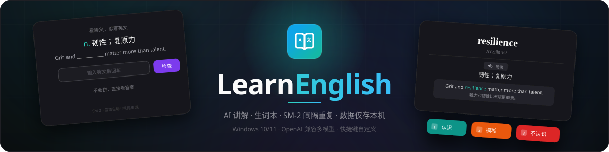

<div align="center">
  

  [](https://github.com/minecraftbucuo/LearnEnglish/releases/latest)
  [](#-下载安装)
  [](#-下载安装)
  [](https://www.electronjs.org/)
  [](https://react.dev/)
  [](https://www.typescriptlang.org/)
  [](https://sqlite.org/)

  **在任意应用里选中英文，按 `Alt+Q`，AI 帮你把单词和句子讲透 —— 然后用间隔重复，科学地记进脑子。**

  [下载安装](#-下载安装) · [功能亮点](#-功能亮点) · [默认快捷键](#-默认快捷键) · [本地开发](#-本地开发)
</div>

---

## 🔄 一次完整的学习闭环

1. **随手查** — 浏览网页、读 PDF、看字幕时选中英文，`Alt+Q` 即刻弹出 AI 讲解卡片，不打断当前工作
2. **一键划** — 觉得值得记，`Ctrl+S` 划入生词本，完整的音标、例句、辨析随之存档
3. **科学记** — SM-2 间隔重复算法安排每天该复习什么，识记 + 拼写两种出题，认不认识由你自己评定

## ✨ 功能亮点

### 🔍 全局快捷查词 — `Alt+Q`

任意应用中选中文本，按快捷键自动抓取并调 AI 讲解：

- **单词**：音标、词性释义、英文释义、双语例句、搭配与近义词辨析
- **句子**：中文翻译、逐词精讲、语法结构分析
- 弹窗内可继续追问，`Esc` 关闭，`Ctrl+S` 划入重点

> **平台差异**：Windows 下自动抓取选中文本；Linux（Wayland）下弹出查询窗后手动输入单词查询（Linux 下自动抓取与截图查询在后续版本支持）。

### 📷 截图查询 — `Alt+X`（仅 Windows）

框选屏幕任意区域，视觉模型 OCR 后按词/句格式讲解。PDF 里的、图片里的、视频字幕里的英文，都能查。

### 📚 生词本 — `Alt+E`

搜索、筛选（词/句/重点）、随手笔记、朗读、暂停复习。查过的每一个词，都有完整的讲解存档。

### 🎯 间隔重复复习

Anki 同款 SM-2 算法，学新词 + 巩固旧词：

- **识记复习**：看单词回忆释义，三档自评（认识 / 模糊 / 不认识），没记住的卡本轮队尾重现
- **拼写复习**：看释义默写单词，不会拼点「不会拼」直接看讲解并回队尾
- 例句挖空提示 · 每日新卡上限 · 连续打卡 · 学习统计

### ⚙️ 多模型适配

一套 OpenAI 兼容配置通吃主流服务：**智谱 / 豆包 / DeepSeek / Kimi / OpenAI** 预设，提示词可微调，快捷键可自定义。

## ⌨️ 默认快捷键

| 快捷键 | 作用 |
| :---: | :--- |
| `Alt+Q` | 划词查询 |
| `Alt+X` | 截图查询 |
| `Alt+E` | 打开生词本 |
| `Ctrl+S` | 划入重点（查询弹窗内） |
| `Esc` | 关闭弹窗 |

> 快捷键冲突或手感不好？全部可以在 **设置** 里改。

## 🚀 下载安装

**Windows**

1. 前往 [**Releases**](https://github.com/minecraftbucuo/LearnEnglish/releases/latest) 下载 `LearnEnglish Setup x.x.x.exe`
2. 双击安装，可自选安装目录

**Linux（x64）**

1. 前往 [**Releases**](https://github.com/minecraftbucuo/LearnEnglish/releases/latest) 下载 `LearnEnglish-x.x.x-x64.AppImage`
2. `chmod +x LearnEnglish-*.AppImage` 加执行权限后直接运行（部分发行版需安装 libfuse2）

**通用**

3. 首次启动进入 **设置**，填入任一 OpenAI 兼容服务的 API Key
4. 在任意应用里选个单词，按 `Alt+Q` ✨

## 🛠 本地开发

```bash
git clone https://github.com/minecraftbucuo/LearnEnglish.git
cd LearnEnglish
pnpm install     # 安装依赖（自动对 better-sqlite3 做 Electron ABI 重编译）
pnpm dev         # 开发模式（主进程热重启 + 渲染进程 HMR）
pnpm typecheck   # 类型检查
pnpm build       # 构建产物
pnpm dist        # 打包：Windows 出 NSIS 安装包，Linux 出 AppImage（输出到 dist/）
```

要求：Node.js ≥ 20、pnpm ≥ 9；Windows 10/11 或 Linux x64（X11 / KDE Wayland）。

## 🧱 技术栈

| 类别 | 技术 |
| :--- | :--- |
| 桌面框架 | Electron 37 |
| 构建工具 | electron-vite |
| 界面 | React 19 + Tailwind CSS 4 |
| 语言 | TypeScript 5.9 |
| 本地存储 | better-sqlite3（SQLite / WAL，零服务依赖） |
| 系统能力 | koffi 调用 Win32 API（Windows 划词抓取与抓屏；Linux 划词暂走手动输入） |

## 📁 数据与隐私

| 内容 | Windows | Linux |
| :--- | :--- | :--- |
| 数据库 | `%APPDATA%\LearnEnglish\learn-english.db` | `~/.config/LearnEnglish/learn-english.db` |
| 配置与 API Key | `%APPDATA%\LearnEnglish\config.json` | `~/.config/LearnEnglish/config.json` |
| 界面偏好 | `%APPDATA%\LearnEnglish\ui-prefs.json` | `~/.config/LearnEnglish/ui-prefs.json` |

> AI API Key 仅保存在本机 `config.json`。除你配置的 AI 服务外，应用不会向任何服务器发送数据。

---

<div align="center">

如果这个工具帮你记住了几个单词，欢迎给个 ⭐ Star

</div>
